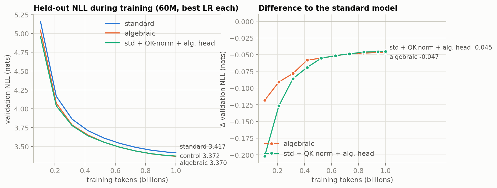
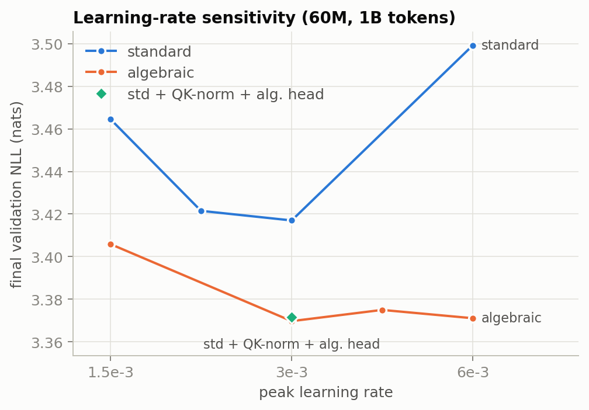
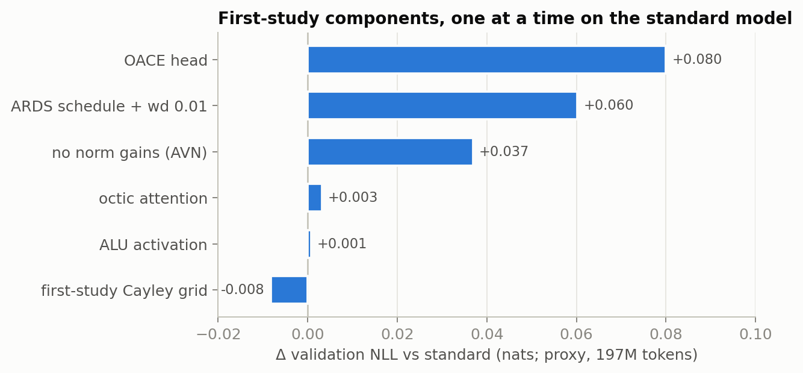
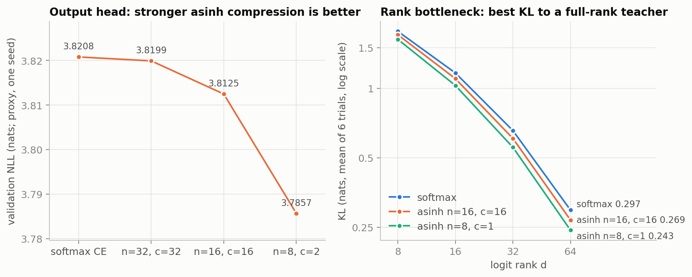
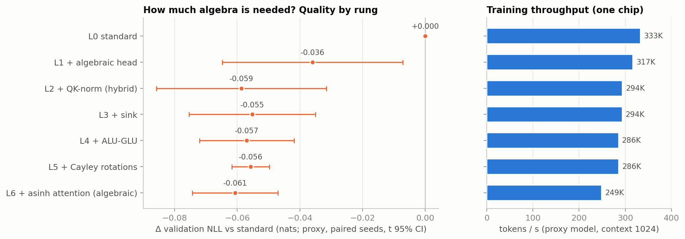

# sota-algebra: a second-generation algebraic Transformer

The [first study](https://github.com/tasmaikeni13/algebraic-transformer)
(tag `v1-original` here) built a causal language model whose training path
avoids exponentials, logarithms, trigonometric and sigmoid functions, and
compared it with a standard Transformer at 125M parameters on 2.5B
FineWeb-Edu tokens. The algebraic model lost narrowly: 25.774 vs 25.548
validation perplexity (paired gap 0.009 nats, 95% CI [−0.011, 0.028]).

This repository finds out **why it lost**, builds a **stronger algebraic
model that beats the standard one**, provides **Pallas TPU kernels for both
architectures**, and prepares the **125M × 3-seed main run** (implementation
and budget hyperparameter sweep; the main run itself is left to the author).

| Phase | Content | Status |
|---|---|---|
| 1 | Statistics, mathematics, and Monte Carlo diagnosis of the first study; ablations; a new algebraic design | done |
| 2 | Flash attention and fused head kernels for both arms | done |
| 3 | 60M models, FineWeb-Edu-1B, 1B tokens, one seed, both arms | done: **algebraic wins** |
| + | How much algebra do we really need? A minimal-algebra hybrid | done: **hybrid wins too, at 88% of standard speed** |
| Speed | Pure/hybrid kernel and complete optimizer-step parity with standard | **ongoing**; hybrid gain reduction improves 125M steps by 3.8%; parity remains open |
| Main | 125M, 3 seeds, 2.5B tokens | implementation and budget sweeps done for all three arms; main run left to the author |

## Headline results

**Phase 3 (60M parameters, 1B tokens, 16 TPU v4 chips, best of four learning
rates per arm):**

| model | held-out NLL | perplexity | tokens/s |
|---|---|---|---|
| standard (RMSNorm, SwiGLU, RoPE, softmax, cross-entropy) | 3.4170 | 30.48 | 2.70M |
| **algebraic (v2d)** | **3.3697** | **29.07** | 1.94M |
| **hybrid (standard + QK-norm + algebraic head)** | **3.3716** | **29.13** | 2.38M |

Every algebraic run (each of its four learning rates) beat the standard's
best run; the hybrid's best (3 learning rates) is within 0.002 of the
algebraic model.


 Proxy experiments (33M parameters, 4 paired seeds) agree:
3.7574 ± 0.0016 vs 3.8182 ± 0.0029, paired difference −0.061 ± 0.004 nats
(t = −14).

**Why the first model lost** — first-study components swapped one at a time
into the standard model (proxy, Δ held-out NLL):

| first-study component | Δ NLL |
|---|---|
| OACE power-score head with vocabulary normalization | **+0.080** |
| rational (ARDS) schedule + weight decay 0.01 | **+0.060** |
| normalization without learned gains | **+0.037** |
| octic attention kernel (n=8, sink) | +0.003 |
| ALU activation | +0.001 |
| Cayley rotations (first-study grid) | −0.008 |



The genuinely algebraic substitutions were free; the gap came from the
training objective, the schedule (it ended at 63% of peak learning rate), and
the missing gains. Details: [analysis/README.md](analysis/README.md); short
mathematics and proofs: [paper/theory.md](paper/theory.md).

## The second-generation algebraic model (v2d)

* **Algebraic maximum-likelihood head.** `p_j ∝ ρ(z_j/c)^n` with
  `ρ(x) = x + √(1+x²)`, n=8, c=2. Its log-loss gradient is algebraic,
  `(n/c)(1+(z_j/c)²)^(−1/2)(p_j − y_j)`, so the model trains on exact
  likelihood without evaluating a logarithm. The entrywise asinh compression
  escapes the softmax rank bottleneck (Monte Carlo: up to 18% lower KL at
  equal rank) and is the largest single source of the win.


* **Asinh-power attention** `ρ(s/8)^16` with a learned per-head sink,
  QK-normalization, and an exact log-free max shift (`ρ(a)ρ(−b) = ρ(a ⊖ b)`);
  at 512 distractors it retrieves at least as precisely as softmax.
* Geometric Cayley rotations, ALU-GLU with β = ½, learned RMS gains,
  cosine AdamW (as specified for the new study).

A primitive-level audit (`scripts/audit_algebraic.py`) confirms the traced
training gradient — including the Pallas kernel bodies — contains no
exponential, logarithmic, trigonometric, hyperbolic, sigmoid or
error-function primitive.

## How much algebra do we really need?

Algebraic pieces were added to the standard model one rung at a time (proxy
scale, 3–4 paired seeds per rung, t 95% intervals):



| rung | Δ NLL vs standard | share of the full gain |
|---|---|---|
| + algebraic likelihood head | −0.036 ± 0.007 | 59% |
| + QK-normalization (**the hybrid**) | **−0.059 ± 0.006** | **97%** |
| + sink, ALU-GLU, Cayley rotations | −0.055 … −0.057 | 91–94% |
| + asinh attention (fully algebraic) | −0.061 ± 0.004 | 100% |

**Answer: two algebraic pieces.** The likelihood head `ρ(z/c)^n` (trained
by its algebraic log-loss gradient) and the rsqrt QK-normalization carry
essentially the whole gain; the other algebraic substitutions are
quality-neutral and are only needed to make the training path entirely free
of transcendentals. At 60M the hybrid beats the standard model by 0.045 nats
at 88% of its throughput, against 72% for the fully algebraic model.

## Kernels (Phase 2)

**Attention speed follow-up:** the current guarded algebraic kernel uses
inverse-denominator statistics, compact row outputs, and a stable fallback
for extreme scores, plus resident-memory dQ accumulation at the measured
bfloat16 model shape. Fifteen paired rounds at the 125M attention shape give
**5.42 ms algebraic vs 3.36 ms standard** for forward plus backward; at the
60M shape, **3.53 vs 2.21 ms**. Speed parity remains open. The follow-up
includes 84 passing TPU checks, 9,216 numerical Monte Carlo rows, alternative
link routing studies, exact rational certificates, and 63 checked Lean
theorems. Experimental links are kept separate from the deployed model.
[Measurements and rejected candidates](paper/attention_performance.md),
[expanded attention theory](paper/attention_exact.md),
[formal coverage](formal/README.md).

The active engineering target includes **both pure algebraic and hybrid**
models, with kernel and full optimizer-step speed compared against the
fastest measured standard implementation at the same shape. Hybrid retains
softmax attention and shares the standard resident-memory FlashAttention
kernel. A checked tiled QK gain-gradient reduction lowers hybrid optimizer
latency by **3.8%**. Three fresh seeds with randomized job order give **156.6 ms
standard, 171.6 ms hybrid, and 181.2 ms pure algebraic**, on one chip at the
125M shape. The remaining full-step gaps are **9.6%** and **15.7%**; parity
is still open. These speed profiles are not new language-model quality runs.
See the [hybrid implementation choice](paper/attention_hybrid.md) and
[current engineering status](paper/attention_performance.md).

The following table records the earlier Phase 2 implementation, before the
current statistics layout and range guard:

One Pallas TPU flash-attention implementation serves both arms (forward;
fused dK/dV/dQ backward; causal tile skipping with diagonal-only masking;
sinks). Forward + backward on one TPU v4 chip, 2048 tokens, head dim 64:

| kernel | 125M shape (8 × 12 heads) | 60M shape (8 × 8 heads) |
|---|---|---|
| this repo, softmax | 4.28 ms | 2.72 ms |
| this repo, asinh (algebraic) | 6.32 ms | 4.09 ms |
| JAX `pallas.ops.tpu.flash_attention` (used by the first study) | 22.14 ms | 14.55 ms |
| dense XLA softmax | 10.80 ms | 7.20 ms |

End to end on 16 chips the kernels make both arms 2–2.6× faster than the
first study (125M: standard 1.58M vs 0.60M tokens/s; algebraic 1.14M vs
0.57M). The vocabulary head uses XLA-dense logits (the fastest measured; the
lean algebraic head is within 14% of softmax cross-entropy); a fused Pallas
head is included as a low-memory option. Raw numbers: `results/kernels/`.

## Running the 125M main run

The budget sweep (three learning rates × three seeds × 600M tokens per
architecture, `configs/main_sweep.json`; held-out NLL, mean ± SD over seeds
42–44) selected **lr 3e-3 for all three architectures**
(`configs/main_selected.json`, every run in `results/main_sweep/runs.json`):

| LR | standard | algebraic | hybrid |
|---|---|---|---|
| 1.5e-3 | 3.8608 ± 0.0088 | 3.7090 ± 0.0137 | 3.7475 ± 0.0095 |
| **3e-3** | **3.8208 ± 0.0145** | **3.6655 ± 0.0063** | **3.6982 ± 0.0149** |
| 6e-3 | 4.1434 ± 0.1382 | 3.7562 ± 0.0488 | 3.7851 ± 0.0135 |

At this short budget the fully algebraic model leads the hybrid by 0.033
nats (it also learns fastest early at 60M); by 1B tokens at 60M the two
were within 0.002. Training throughput on 16 chips at 125M: standard 1.53M,
hybrid 1.36M, algebraic 1.10M tokens/s. Then, on a TPU v4-32 with hosts
`w0..w3` reachable over SSH (see `scripts/setup_workers.sh`):

```bash
python scripts/prepare_fineweb_edu.py --output-dir ~/data/fw25 --threads 128   # 2.5B + 600M + 10M tokens
python scripts/prepare_eval_benchmarks.py --output-dir ~/data/evals            # zero-shot tasks
python scripts/main_run.py main > main.json         # 3 seeds x {standard, algebraic, hybrid}, 2,385 steps each
# (add --archs standard,algebraic to run only the two original arms)
python scripts/run_slice.py main.json --group main  # rerun the same command to resume (checkpoints every 200 steps)
python scripts/evaluate_zero_shot.py runs/main/algebraic_s42 --out results/main/algebraic_s42_zero_shot.json
```

Expected wall time per run on 16 chips: about 30 minutes (standard),
35 minutes (hybrid), and 40 minutes (algebraic).

## Layout

| path | contents |
|---|---|
| `src/sota/` | model (`model.py`), algebraic and standard components, presets (`config.py`), trainer with checkpoint/resume (`train.py`) |
| `src/sota/kernels/` | Pallas flash attention (`flash.py`) and fused head (`fused_head.py`) |
| `analysis/` | Phase 1 statistics and Monte Carlo, ablation job lists, Phase 3 jobs and summary |
| `scripts/` | data preparation, 16-chip job queue (`run_queue.py`), full-slice launcher (`run_slice.py`), main run (`main_run.py`), zero-shot evaluation, benchmarks, audit |
| `configs/` | budget-sweep candidates and the selected main-run hyperparameters |
| `results/` | `analysis/` (Phase 1 and Monte Carlo outputs), `phase3/`, `main_sweep/`, `kernels/`, `figures/`, and the first study's records (`v1/`) |
| `paper/theory.md` | concise mathematics, proofs, and measured status of each claim |

The first study's code, Lean certificates, paper, and microbenchmark records
are preserved under the `v1-original` tag (and in the original repository);
its run records used by the analysis are in `results/v1/`.

## Reproduce

```bash
python3 -m virtualenv ~/venv && ~/venv/bin/pip install -r requirements-tpu.txt
python scripts/prepare_fineweb_edu_1b.py --raw-dir <parquet dir> --output-dir ~/data/tok
JAX_PLATFORMS=cpu python -m pytest -q tests/test_sota_components.py   # TPU kernel tests: tests/test_*_tpu.py
python -m src.sota.train --preset algebraic --size proxy --steps 3000 --out runs/demo   # one chip
python analysis/phase1_jobs.py batch5 > jobs.json && python scripts/run_queue.py jobs.json --group p1
python analysis/phase3_jobs.py sweep > p3.json && python scripts/run_slice.py p3.json --group p3
```
