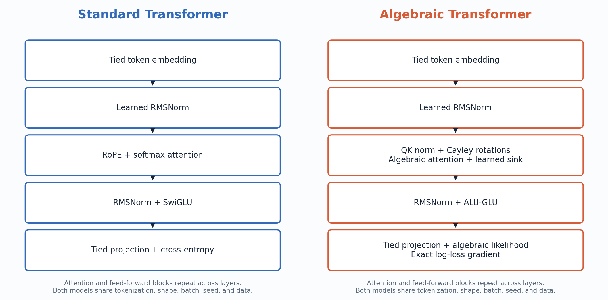
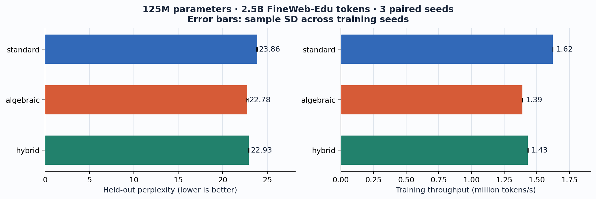
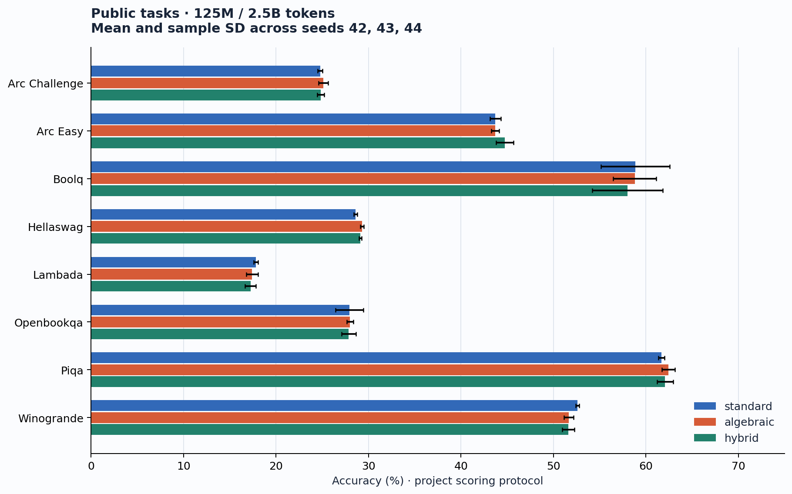
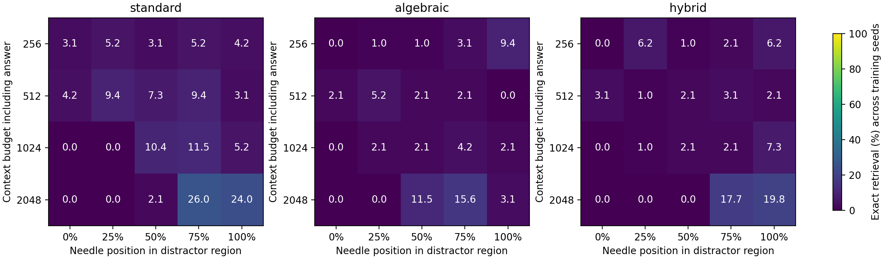

# Algebraic Transformer

Causal language models with an algebraic attention kernel, Cayley positional rotations, and an output head whose exact log-loss gradient uses arithmetic and reciprocal square roots. The repository includes a matched standard Transformer, an optional hybrid, fused Pallas TPU kernels, reproducible training configurations, and public-task and recall evaluation.

The pure algebraic **model objective and its gradient** avoid exponential, logarithmic, trigonometric, sigmoid, and hyperbolic primitives. Initialization, the shared cosine learning-rate schedule, and metric reporting are outside that claim. See [the mathematics](paper/theory.md) and [primitive audit](scripts/audit_algebraic.py).



## Measured results

The completed comparison trains approximately **125M parameters on 2.5B [FineWeb-Edu](https://huggingface.co/datasets/HuggingFaceFW/fineweb-edu) tokens**, with paired seeds **42, 43, 44**. Values below are mean ± sample SD across training seeds; throughput is trainer telemetry on 16 TPU v4 chips.

| Model | Held-out NLL | Perplexity | Million tokens/s |
|---|---:|---:|---:|
| Standard | 3.1723 ± 0.0024 | 23.86 ± 0.06 | 1.62 |
| Pure algebraic | 3.1258 ± 0.0026 | 22.78 ± 0.06 | 1.39 |
| Hybrid | 3.1323 ± 0.0011 | 22.93 ± 0.03 | 1.43 |



The algebraic model has lower held-out perplexity. Public-task differences are mixed: it improves HellaSwag and PIQA in this comparison, while several other tasks are similar or lower. Free recall is low for all models; recognition and generation are reported separately. These results do not imply a universal accuracy or retrieval advantage.





The [complete comparison](results/main/comparison.md) includes all public tasks, recall controls, matched-seed differences, and the full context/position matrix. [Per-example predictions and provenance](results/main) support the tables. Presentation paths and protocol names are normalized; checkpoint hashes, dataset hashes, recorded source fingerprints, predictions, and scores are preserved.

## Models and kernels

| Component | Standard | Pure algebraic |
|---|---|---|
| Normalization | Learned RMS gains | Learned RMS gains, plus QK normalization |
| Feed-forward | SwiGLU | ALU-GLU, β = ½ |
| Positions | RoPE | Geometric Cayley rotations |
| Attention | Causal softmax | `ρ(s/8)^16`, learned per-head sink |
| Output distribution | Softmax | `ρ(z/2)^8` |
| Objective gradient | Cross-entropy | Exact algebraic log-loss gradient |

Here `ρ(x) = x + √(1 + x²)`. Token embeddings and the output projection are tied. The hybrid uses standard attention and feed-forward components with QK normalization and the algebraic likelihood head.

Pallas provides tiled attention forward/backward, a vocabulary projection/loss kernel, and a QK gain-gradient reduction. The 350M and 1B configurations enable **fused attention and the fused head** for both arms. The head uses 128-token × 512-vocabulary tiles, verified at both widths. Dense components remain available for CPU checks. [Kernel measurements](paper/attention_performance.md), [numerical identities](paper/attention_exact.md), and [Lean certificates](formal/README.md) document scope and limitations.

## Install

Python 3.10 or newer:

```bash
python3 -m venv .venv
source .venv/bin/activate
pip install -r requirements.txt
pip install -e . --no-deps
JAX_PLATFORMS=cpu python -m pytest -q tests/test_components.py tests/test_experiments.py
```

For TPU workers, install `requirements-tpu.txt` instead of `requirements.txt`. The pinned environment uses JAX 0.6.2. `scripts/tpu_python.sh` isolates one local TPU chip and uses `.venv/bin/python`, `~/venv/bin/python`, or `ALGEBRAIC_PYTHON`.

## 350M and 1B experiments

Both comparisons use **standard vs pure algebraic**, **one paired seed (42)**, GPT-2 tokenization, a 2,048-token context, AdamW, a cosine schedule, and the same data seed. Models are matched in width, depth, feed-forward width, and tied vocabulary embedding; QK gains and learned sinks account for the small parameter difference.

| Configuration | Standard parameters | Algebraic parameters | Training budget | Steps | Per-device micro-batch |
|---|---:|---:|---:|---:|---:|
| [350M](configs/comparison_350m.json) | 350,358,528 | 350,361,984 | 7B tokens | 6,676 | 2 |
| [1B](configs/comparison_1b.json) | 1,002,140,160 | 1,002,145,024 | 20B tokens | 19,074 | 1 |

Global batch is 512 sequences. Budgets round up to complete optimizer steps: **7,000,293,376** and **20,000,538,624** token presentations. Corpus arrays contain exactly 7B and 20B tokens. The trainer samples deterministic contiguous windows, so token presentations are a compute budget rather than a claim of one pass through every corpus token.

**These full runs have not been launched here.** The implementations were smoke-tested with one synthetic optimizer step at each full model shape, including fused kernels and checkpoint reload. One-step checks also verify the production batch and gradient accumulation across all 16 TPU chips. Synthetic loss values are execution checks, not benchmark results. Reports are in [results/verification](results/verification).

### Budgeted hyperparameter sweeps

Each scale tests **four candidates per architecture** using one seed: three learning rates and one lower-weight-decay alternative. Both arms receive identical pilot data and validation windows. Selection minimizes held-out NLL independently for each architecture and requires every pilot to complete with finite results.

| Sweep | Tokens per candidate | Runs | Total nominal pilot tokens | Fraction of full two-arm budget |
|---|---:|---:|---:|---:|
| [350M](configs/sweep_350m.json) | 100M | 8 | 800M | 5.7% |
| [1B](configs/sweep_1b.json) | 200M | 8 | 1.6B | 4.0% |

Pilots also round up to full steps. They save one resumable optimizer checkpoint and omit final weight exports to reduce disk use. Short-budget rankings do not establish full-budget optimality. The main launcher requires the sweep selection before starting training.

### Prepare data

The preparer discovers all required parquet shards at an immutable source revision, separates validation and training documents, inserts GPT-2 end-of-text separators, and publishes arrays only after every quota is filled. It fails if the source is exhausted.

```bash
# 350M corpus: exactly 7B training tokens, plus 10M held-out tokens.
python scripts/prepare_fineweb_edu.py --output-dir ~/data/fw7b \
  --train-tokens 7000000000 --sweep-tokens 0 --threads 32

# 1B corpus: exactly 20B training tokens from the larger sample.
python scripts/prepare_fineweb_edu.py --output-dir ~/data/fw20b \
  --dataset-path sample/100BT --train-tokens 20000000000 --sweep-tokens 0 --threads 32

python scripts/prepare_eval_benchmarks.py --output-dir ~/data/evals
python scripts/prepare_recall_benchmarks.py --config configs/comparison_350m.json \
  --output-dir ~/data/recall_350m
python scripts/prepare_recall_benchmarks.py --config configs/comparison_1b.json \
  --output-dir ~/data/recall_1b
```

Use the same absolute repository, environment, and data paths on all four TPU workers. Configure SSH aliases `w0,w1,w2,w3`; copy token arrays to every worker. Run the launchers from worker zero. Code synchronization is handled by [setup_workers.sh](scripts/setup_workers.sh). Token arrays require about **14GB** and **40GB** per worker, plus validation, raw-shard downloads, and optimizer checkpoints.

### Plan, sweep, train, and evaluate

Commands without `--run` or `--stage run` print plans and start no training.

```bash
# 350M: inspect the sweep, run the short pilots, and select settings.
python scripts/hparam_sweep.py --scale 350m
python scripts/hparam_sweep.py --scale 350m --stage run
python scripts/hparam_sweep.py --scale 350m --stage select
python scripts/run_comparison.py --scale 350m
python scripts/run_comparison.py --scale 350m --run

# 1B: independently select settings before the 20B-token comparison.
python scripts/hparam_sweep.py --scale 1b
python scripts/hparam_sweep.py --scale 1b --stage run
python scripts/hparam_sweep.py --scale 1b --stage select
python scripts/run_comparison.py --scale 1b
python scripts/run_comparison.py --scale 1b --run
```

Selections are written to `results/tuning_<scale>/selected.json`. Full checkpoints go to `runs/comparison_<scale>/`; evaluation outputs go to `results/comparison_<scale>/`. Repeating the commands resumes checkpoints and reuses only validated, matching completed outputs. The pipeline trains both models before running all benchmarks. [Training details](paper/training.md) cover configuration, resume, and separate evaluation commands.

## Benchmark protocol

Every completed model receives **ARC-Easy, ARC-Challenge, HellaSwag, PIQA, OpenBookQA, WinoGrande, BoolQ, and LAMBADA**, plus **needle passkey retrieval, associative recall, multiple-needle retrieval, and latest-value recall**. The 350M and 1B runs retain the 125M prompts and scoring rules so results can be compared across scales.

Recall covers 256/512/1,024/2,048-token total budgets, five evidence positions, 32 trials per cell, 16 generated answer tokens, absent-evidence controls, and short-context controls. Evidence is never truncated. Outputs include predictions, checkpoint/dataset/source hashes, matched-model differences, per-cell intervals, and heatmaps. Single-seed comparisons report individual scores and paired differences; they do not estimate variance across training seeds. See the [evaluation protocol](paper/post_training_evaluation.md).

## Verification and reproduction

```bash
# Actual full model shapes, one synthetic optimizer step each; no corpus training.
bash scripts/tpu_python.sh 0 scripts/smoke_comparison.py --scale 350m
bash scripts/tpu_python.sh 0 scripts/smoke_comparison.py --scale 1b
bash scripts/tpu_python.sh 0 -m pytest -q \
  tests/test_flash_kernel_tpu.py tests/test_fused_head_tpu.py tests/test_qk_norm_tpu.py
# Optional distributed synthetic verification from worker zero:
JAX_PLATFORMS=cpu python scripts/smoke_distributed.py --scale 350m
JAX_PLATFORMS=cpu python scripts/smoke_distributed.py --scale 1b

# Rebuild figures from the published 125M results.
python scripts/summarize_main_eval.py
python analysis/plot_figures.py

# 125M / 2.5B tokens, three architectures and seeds.
python scripts/main_run.py main > jobs.json
python scripts/run_slice.py jobs.json --group main --skip-done
bash scripts/tpu_python.sh 0 scripts/evaluate_main.py --resume
```

| Path | Contents |
|---|---|
| `src/algebraic/` | Model presets, trainer, numerical components, scoring, and recall generator |
| `src/algebraic/kernels/` | Pallas attention, fused vocabulary head, and QK reduction |
| `configs/` | Frozen comparisons, budget sweeps, and evaluation matrices |
| `scripts/` | Data preparation, experiment launchers, audits, and benchmark drivers |
| `analysis/` | Figure generation, numerical studies, and performance probes |
| `results/` | Measured comparisons, per-example predictions, figures, and smoke evidence |
| `paper/`, `formal/` | Mathematical notes, protocols, and Lean certificates |

TPU experiments were supported by Google's TPU Research Cloud (TRC).
