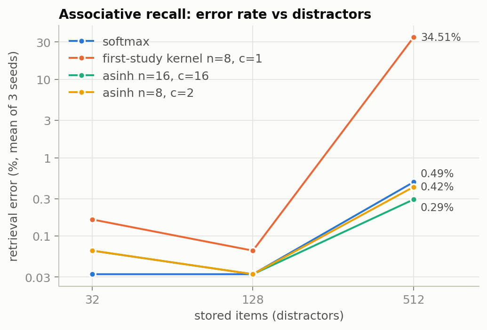

# Phase 1: why the first algebraic model lost, and what beats the standard

Every number here is produced by a script in this directory; JSON outputs
are in `results/analysis/`. The concise mathematics is in
`paper/theory.md`.

| File | What it does |
|---|---|
| `v1_statistics.py` | Paired seed statistics of the first study's 125M runs, the 18-run tuning sweep, schedule areas, and an LR-annealing scaling-law fit |
| `head_analysis.py` | Monte Carlo: representational floor of each head, cost of OACE vs log-loss under misspecification (B), rank bottleneck of softmax vs asinh links (C) |
| `verify_head_eval.py` | Independent float64 recomputation of a saved model's held-out NLL |
| `phase1_summary.py` | Paired-by-seed statistics of the Phase 1 headline comparisons |
| `phase3_summary.py` | Phase 3 table, best learning rate per arm, curves |
| `attention_analysis.py` | Monte Carlo: attention entropy at initialization per kernel, associative recall across kernels, positional-resolution linear programs |
| `activation_analysis.py` | ALU vs SiLU/GELU: best-matching sharpness, mean-field moments, tails |
| `phase1_jobs.py` | The ablation batches (job lists for `scripts/run_queue.py`) |
| `phase3_jobs.py` | The 60M / 1B-token comparison (job lists for `scripts/run_slice.py`) |
| `summarize_runs.py` | Tables of held-out NLL, paired differences, and validation curves |
| `plot_figures.py` | The figures in `results/figures/` from the recorded JSON outputs |

## 1. Statistics of the first study (`v1_statistics.py`)

* 125M final runs: paired NLL gap 0.0088 nats, 95% CI [−0.011, 0.028],
  posterior P(algebraic worse) = 0.90; 9 paired seeds would be needed for
  80% power at the observed effect. The 81,920-token validation subset is
  small but shared, so the paired comparison is still informative.
* The tuning sweep picked the largest learning rate offered for both arms
  (1e-3): the optimum lay outside the searched range.
* The algebraic arm's ARDS schedule ends at 0.63× peak learning rate
  (cosine: 0.05×) and averages 0.84× (cosine: 0.52×). An annealing-law fit
  on the standard arm's traces predicts that schedule alone costs 0.115
  nats at 125M (90% CI 0.087–0.185): larger than the observed gap.
* In the 20M pilot the algebraic arm's gradient was clipped on 99.999% of
  steps (standard: 0.19%): OACE's gradient scale is ~16× that of
  cross-entropy.

## 2. Mathematics and Monte Carlo of the components

* **Head.** Training the first study's link on OACE instead of log-loss
  costs ≈0.03 nats of test cross-entropy under misspecification (12-trial
  Monte Carlo); the asinh link is slightly better than softmax at equal rank.
  The algebraic head can be trained by exact maximum likelihood (its
  log-loss gradient is algebraic), which removes the objective mismatch.
* **Attention.** `ρ(s)^8` is degree-8 homogeneous for large scores, so
  normalized weights stop sharpening as scores grow: entropy saturates at
  0.42·log T (softmax: 0.06·log T) in the random-score Monte Carlo.
* **Positions.** The first-study Cayley grid has 2 of 32 pairs with
  wavelength < 64 tokens (RoPE: 9) and 2–4× smaller position-only margins,
  yet it was not harmful in training: its static pairs act like partial
  rotary dimensions.
* **Activation.** ALU(β=1) is closer to GELU than SiLU (best SiLU match
  β ≈ 0.6) with a heavy algebraic negative tail.

## 3. Ablations at the proxy scale (`phase1_jobs.py`)

33M-parameter proxy, context 1024, 196.6M tokens, 2M held-out tokens,
seed-to-seed SD ≈ 0.003 nats (standard, 3 seeds: 3.8201 ± 0.0018 SE).

First-study components swapped one at a time into the standard model:
OACE head +0.080, ARDS schedule + wd 0.01 +0.060, no norm gains +0.037,
octic attention +0.003, ALU +0.001, Cayley grid −0.008. The genuinely
algebraic substitutions are free; the gap came from the objective, the
schedule, and the missing gains. Reverse checks inside v1: CE instead of
OACE −0.122, gains −0.103.

Second-generation exploration (single changes to the provisional v2,
3.8146 ± 0.0017 over 3 seeds): stronger asinh compression in the head is
monotonically better (CE 3.8208, n=c=32 3.8199, n=c=16 3.8125,
n=8/c=2 3.7857); QK-norm 3.7910; first-study Cayley grid 3.7979;
ALU β=0.5 3.8058; softmax attention 3.8059; attention n=c=16 3.8176.

## 4. Final Phase 1 design and statistics (`phase1_summary.py`)

Batches 3–5 combined the winners, tuned the head and attention kernels
under QK-normalization, and added controls. Held-out NLL (mean ± SE over
seeds; runs with equal seeds are paired):

| model | seeds | NLL |
|---|---|---|
| standard | 4 | 3.8182 ± 0.0029 |
| first-study algebraic (v1) | 1 | 3.9608 |
| v2 provisional | 3 | 3.8146 ± 0.0017 |
| v2c (+ n=8/c=2 head, QK-norm, v1 grid, ALU β=½) | 4 | 3.7647 ± 0.0025 |
| hybrid: v2c with softmax attention | 3 | 3.7617 ± 0.0021 |
| **v2d: final algebraic (attention n=16/c=8, geometric grid)** | 4 | **3.7574 ± 0.0016** |
| standard + QK-norm + algebraic head (control) | 3 | 3.7613 ± 0.0047 |

* **v2d − standard = −0.061 ± 0.004 nats (t = −14.1, p = 0.0008).**
* v2d − (standard + QK-norm + algebraic head) = −0.004 ± 0.005 (p = 0.50):
  with the same head and QK-norm, the fully algebraic backbone (ALU-GLU,
  Cayley rotations, asinh attention with sink) matches the standard
  backbone. The win over the standard baseline is carried by the algebraic
  likelihood head and QK-normalization, both of which also transfer to a
  standard backbone (−0.059 together).
* Around v2d, single-seed variants are within noise (sink removed −0.005,
  ALU β 0.6/0.75 −0.003/−0.002, head c 1.5/3 ±0.001, attention n=32/c=16
  −0.001); partial rotary (+0.009) and a lower learning rate (+0.026) hurt.
* The algebraic head's held-out NLL was recomputed from its definition in
  float64 NumPy from saved parameters: probabilities sum to 1 within 1e-15
  and the NLL matches the trainer to 2e-7 (`verify_head_eval.py`).

Associative recall (Monte Carlo, 512 distractors): softmax 99.5% accuracy,
first-study kernel 65% with seed failures — the empirical face of the
degree-8 homogeneity ceiling that motivated the n=16, c=8 kernel.

## 5. Phase 3: 60M parameters, 1B tokens, one seed (`phase3_jobs.py`, `phase3_summary.py`)

16 TPU v4 chips, FineWeb-Edu-1B, context 2048, 524,288-token batches,
1,908 steps (1,000,341,504 tokens), cosine AdamW, 8M held-out tokens. Each
arm received the same LR budget (four values, the fourth placed at its fitted
optimum); results in `results/phase3/summary.json`.

| run | LR | NLL | PPL |
|---|---|---|---|
| standard | 1.5e-3 | 3.4644 | 31.96 |
| standard | 2.12e-3 | 3.4215 | 30.62 |
| **standard (best)** | 3e-3 | **3.4170** | **30.48** |
| standard | 6e-3 | 3.4992 | 33.09 |
| algebraic | 1.5e-3 | 3.4058 | 30.14 |
| **algebraic (best)** | 3e-3 | **3.3697** | **29.07** |
| algebraic | 4.24e-3 | 3.3750 | 29.22 |
| algebraic | 6e-3 | 3.3711 | 29.11 |
| control: standard + QK-norm + algebraic head | 3e-3 | 3.3716 | 29.13 |

**The algebraic model wins: −0.047 nats, perplexity 29.07 vs 30.48 (ratio
0.954).** Every algebraic learning rate beats the standard's best, and the
algebraic model is markedly less sensitive to the learning rate. It leads
from the first evaluation (step 200) to the end, and by a near-constant
0.04–0.05 nats at every context position beyond the first few tokens.
Throughput: 1.94M vs 2.70M tokens/s (0.72×).

## 6. Monte Carlo conclusions

* Objective (12 trials): OACE vs log-loss on the same link +0.0289 ± 0.0009;
  first-study link vs softmax +0.0033 ± 0.0009; asinh n=c=16 link vs
  softmax −0.00226 ± 0.00008 nats.
* Rank bottleneck (6 trials per rank): asinh (n=8, c=1) lowers the best
  achievable KL to a full-rank teacher by 7.7%, 11.7%, 15.4%, 18.1% at ranks
  8, 16, 32, 64 (paired SE ≤ 0.0013) — the mechanism behind the head's gain.
* Associative recall, 512 distractors (3 seeds): softmax 99.51%; first-study
  kernel 65% with seed failures; asinh n=16/c=16 99.71%, n=8/c=2 99.58%,
  n=32/c=32 99.54%.
